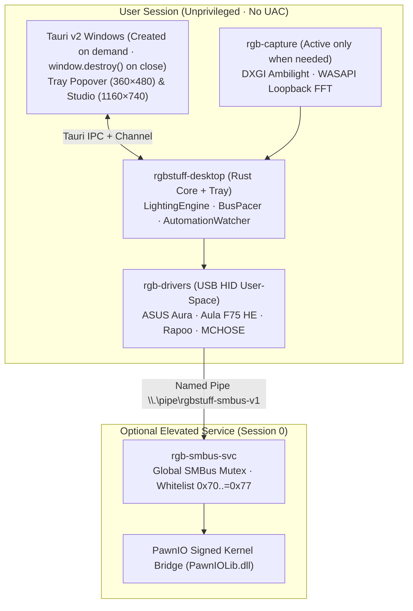

[🇧🇷 Leia em Português (Brasil)](./README.pt-BR.md)

# RGBStuff

**Ultra-lightweight Rust + Tauri v2 unified RGB controller and peripheral telemetry hub for Windows 11.**

Built to replace bloated, freemium background lighting suites and fragmented vendor hubs (`A HUB`, `Aula Hub`, `MCHOSE HUB`) with a native Rust daemon, a Windows 11 Mica UI that frees WebView2 memory completely when closed, and **0% background CPU** for static/gaming profiles.

---

## Key Features

- **Zero-WebView2 Background Footprint:** Starts silently in the Windows System Tray (`windows: []`). Both the **Tray Popover** (`360×480`) and **Studio** (`1160×740`) windows are created on demand with Windows 11 Mica (`window-vibrancy`) and completely **destroyed (`window.destroy()`)** when closed or unfocused.
- **Hybrid 2D Spatial Canvas (`rgb-engine`):** `128×72` internal RGB canvas with bilinear sampling per device LED, per-bus rate limiting (`BusFramePacer`: Aura 60 Hz, Aula 30 Hz, RAM 15 Hz), and `DirtyFrameTracker` to skip redundant USB/SMBus writes.
- **Zero-CPU Static Mode:** Effects like `Off`, `Solid`, and `Gradient` apply once and suspend the engine loop via `tokio::sync::Notify` (`0.0%` CPU). The default **Gaming** preset uses static `Gradient` so lighting never steals CPU/GPU cycles in games.
- **Demand-Driven Screen Ambilight & Audio Reactive (`rgb-capture`):**
  - **DXGI Desktop Duplication (`64×36`):** Spins up **only** when the active profile uses `Ambilight` and tears down all D3D11/DXGI handles immediately when switching away.
  - **WASAPI Loopback + `rustfft`:** 16 logarithmic frequency bands with Hann windowing, active **only** in `AudioSpectrum` mode.
- **Focus-Aware App Rules & Windows Automations (`rgb-automation`):**
  - Automatically switches profiles when a target app or game enters focus (default rules include `feathertune.exe → ambilight`, `vlc.exe → ambilight`, `cs2.exe → gaming`) and restores the previous profile when focus leaves.
  - Ignores transient OS overlays and RGBStuff itself so opening the tray popover never overrides an active rule.
  - Includes a **1-click Running Apps Picker** (`EnumWindows`) in the Automations tab.
  - Handles `Win+L` (`WTSRegisterSessionNotification`), sleep/wake USB recovery (`WM_POWERBROADCAST`), idle timeout (`GetLastInputInfo`), scheduled Night Mode dimming, and native Windows low-battery notifications.
- **Read-Only Hub Preset Importer (`rgb-core::hub_importer`):** Reads local non-sensitive configs/metadata from **A HUB (Rapoo)**, **Aula Hub**, and **MCHOSE HUB** without modifying vendor files or touching cookies/auth data.
- **Full Internationalization (`pt-BR` / `en-US`):** Instant live language switching synced to atomic TOML config persistence.

---

## Supported Hardware

| Component | Target Hardware | VID:PID / Bus | Capabilities (Phase 1) |
| :--- | :--- | :--- | :--- |
| **Motherboard & Fans ARGB** | ASUS TUF GAMING A520M-PLUS II (Aura Gen2) | `0B05:19AF` (`USB HID`, `0xFF72`) | Direct per-LED streaming across 2 ARGB headers (configurable LED counts) |
| **DRAM RGB** | Asgard DDR4-3200 (2×8 GB, ENE controller) | `1022:790B` (`AMD SMBus` via **PawnIO**) | Guarded per-LED updates via optional `rgb-smbus-svc` |
| **Keyboard** | Aula F75 HE | `38A6:2729` (`USB HID`, `0xFF68`/`0xFF67`) | Spatial canvas mapping & live connection detection (per-key streaming in progress) |
| **Mouse** | Rapoo VT0 / VT Air Max | `24AE:14A1` (`USB HID`, `0xFF00`) | Passive battery %, charging state & DPI telemetry (Report `0x07`) |
| **Headset** | MCHOSE V9 Pro 2 | `3837:6011` (`USB HID`, `0xFF07`) | Passive connection & battery telemetry |

---

## Architecture Overview

RGBStuff separates **user-session hardware/UI** from **privileged SMBus RAM writes** so the main app never triggers UAC prompts at startup and DXGI/WASAPI always run cleanly in the interactive session.



See [docs/ARCHITECTURE.md](./docs/ARCHITECTURE.md) for full technical details and [docs/protocols/hardware-probe.md](./docs/protocols/hardware-probe.md) for captured device descriptors.

---

## Safety & Anti-Cheat Design

- **No WinRing0:** Uses **PawnIO** (`PawnIOLib.dll`) instead of blacklisted `WinRing0x64.sys`, keeping Windows Defender and modern anti-cheats happy.
- **Global SMBus Synchronization:** Acquires Windows mutex `Global\Access_SMBUS.HTP.Method` before SMBus operations to coexist safely with HWiNFO, CPU-Z, and AIDA64.
- **Hard-Coded SPD EEPROM Protection:** `rgb_drivers::validate_smbus_address` strictly enforces a `0x70..=0x77` whitelist and blocks `0x50..=0x57` (SPD EEPROM) at both the client and service boundaries.

---

## Workspace Structure

```text
RGBStuff/
├── crates/
│   ├── rgb-core/          # Color math, device traits, atomic TOML config, Hub Preset Importer
│   ├── rgb-engine/        # 128×72 Canvas2D, bilinear sampling, effects, BusFramePacer, Zero-CPU sleep
│   ├── rgb-drivers/       # ASUS Aura USB, Aula F75 HE, Rapoo, MCHOSE, ENE DRAM IPC, SMBus guard
│   ├── rgb-capture/       # Demand-driven DXGI Desktop Duplication & WASAPI Loopback + rustfft
│   ├── rgb-automation/    # Win+L lock, sleep/wake, idle, night schedule, foreground app rules
│   └── rgb-smbus-svc/     # Optional elevated SMBus Named Pipe service using PawnIOLib.dll
├── apps/
│   └── desktop/           # Tauri v2 + React 19 + TypeScript + Tailwind v4 + Radix UI + Zustand + i18n
├── tools/
│   └── hid-probe/         # CLI hardware probe for safe VID:PID, Aura firmware & PawnIO checks
└── docs/
    ├── ARCHITECTURE.md
    └── protocols/hardware-probe.md
```

---

## Build & Development

### Prerequisites (Windows 11)
- **Rust** (`1.85+` / Edition 2024) + MSVC Build Tools
- **Bun** (`1.2+`) for frontend dependency management & Vite builds
- **PawnIO** *(optional, only required for Asgard DDR4 SMBus RAM RGB)*

### 1. Frontend Build
```powershell
cd apps\desktop
bun install
bunx tsc --noEmit
bun run build
```

### 2. Run All Tests
```powershell
cargo test --workspace
```

### 3. Hardware Probe CLI (Optional)
```powershell
cargo run -p hid-probe -- list
cargo run -p hid-probe -- aura-info
cargo run -p hid-probe -- pawnio-check
```

### 4. Build Release Binaries
```powershell
cargo build --release -p rgbstuff-desktop -p rgb-smbus-svc
```
Outputs:
- `target\release\rgbstuff-desktop.exe`
- `target\release\rgb-smbus-svc.exe`

---

## Roadmap

- **Phase 1 (Complete):** Unified RGB engine, 2D spatial canvas, ASUS Aura USB direct mode, PawnIO SMBus safety service, demand-driven DXGI Ambilight & WASAPI Audio, focus-aware app rules, Win+L/idle/night automations, read-only 3-Hub importer, and Tauri v2 Mica UI (`pt-BR` / `en-US`).
- **Phase 2 (Next):** Full bidirectional replacement of `A HUB` (DPI stages, polling rate, LOD, debounce), `Aula Hub` (Hall Effect 0.1–4.0 mm actuation, Rapid Trigger, DKS/SOCD, per-key live streaming), and `MCHOSE HUB` (10-band onboard EQ, mic sidetone).
- **Phase 3 (Future):** Declarative JSON/TOML device layout manifests for community hardware support.

## License

[MIT](./LICENSE)
