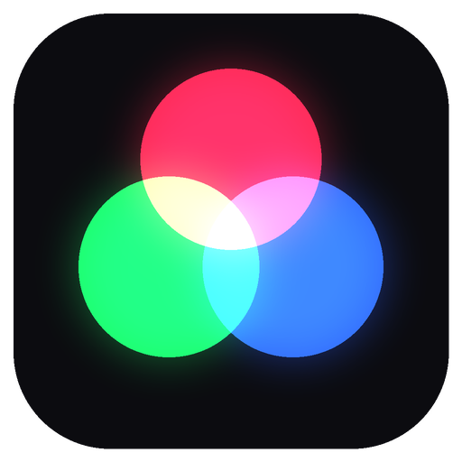
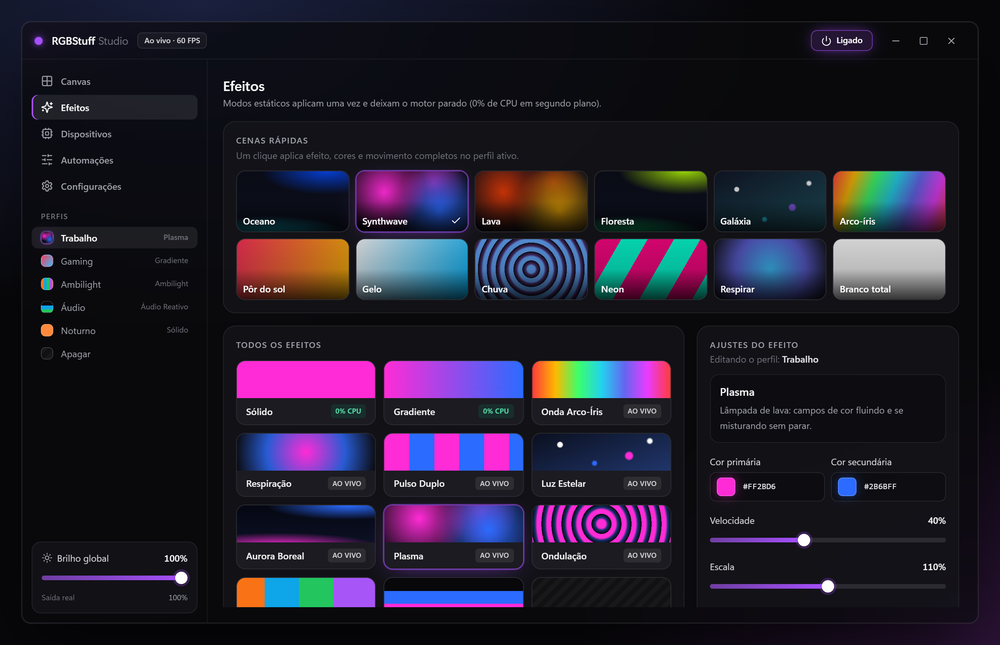
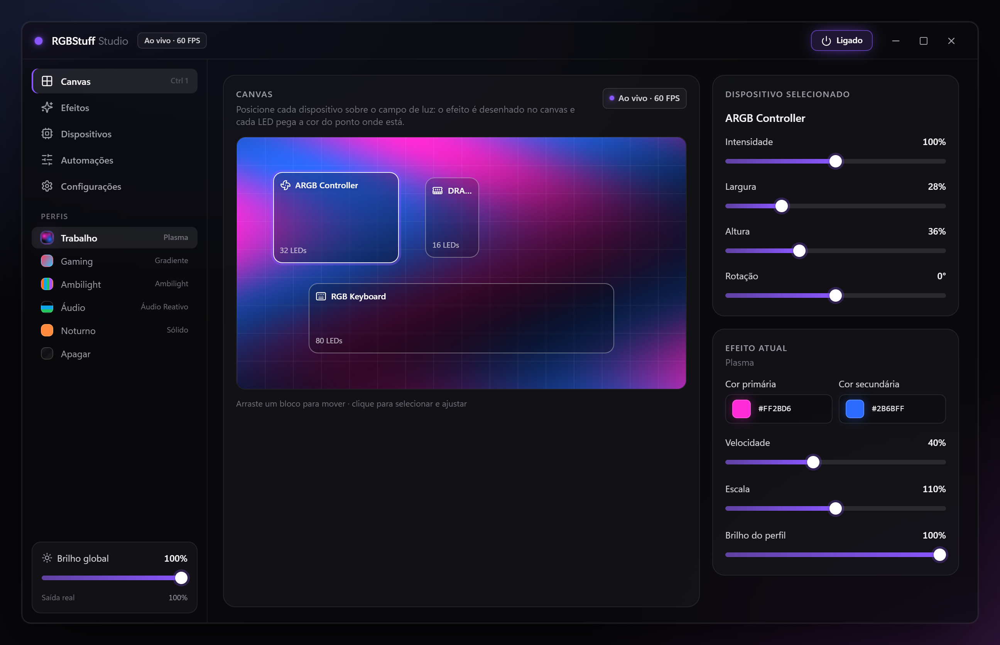
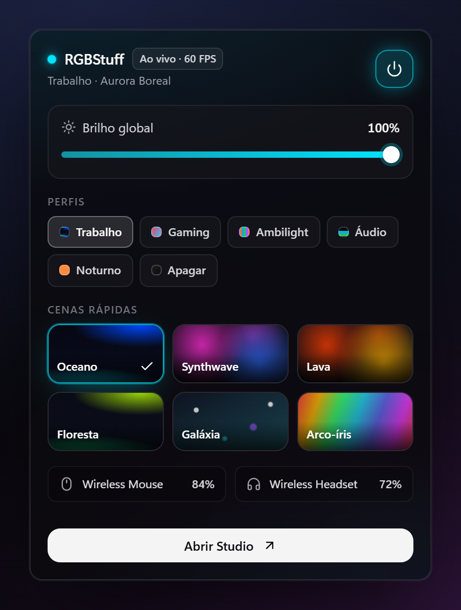

<p align="center">
  
</p>

<h1 align="center">RGBStuff</h1>

<p align="center"><strong>One small app for all the RGB on your desk.</strong><br>Fans, RAM and keyboard on one light canvas, battery of your mouse and headset in the tray, and 0% CPU when nothing moves.</p>

<p align="center">
  <a href="https://github.com/bps2414/RGBStuff/releases/latest"><strong>Download</strong></a> ·
  <a href="#how-it-works">How it works</a> ·
  <a href="#supported-hardware">Hardware</a> ·
  <a href="#faq">FAQ</a> ·
  <a href="README.pt-BR.md">Português</a>
</p>

<p align="center">
  <a href="https://github.com/bps2414/RGBStuff/releases/latest"></a>
  <a href="https://github.com/bps2414/RGBStuff/releases"></a>
  
  
  <a href="LICENSE"></a>
</p>



## Why RGBStuff

- **One app instead of four.** Vendor hubs each want their own tray icon, service and updater. RGBStuff drives the motherboard ARGB, the RAM and the keyboard from one Rust process.
- **Free when it's still.** Static looks (solid, gradient, off) are written once and the engine goes to sleep: 0% CPU while you game.
- **Lives in the tray.** Closing the window destroys it to give WebView2's memory back; the lighting keeps running. A click on the icon brings everything back.
- **Your whole setup is one picture.** Effects are drawn on a 2D canvas and every LED takes the color under it, so a wave really crosses from the fans to the keyboard.

## How it works

1. **Install** `RGBStuff_<version>_x64-setup.exe`. No admin rights needed, no Visual C++ runtime to download.
2. **Pick a quick scene** (Ocean, Synthwave, Lava, Galaxy…) or build your own in **Effects**: only the controls that change the current effect are shown.
3. **Arrange** your devices on the **Canvas** so effects flow across the desk the way they're placed in real life.
4. **Forget about it.** Turn on *Start with my PC* in **Settings**: RGBStuff starts hidden in the tray and applies your lighting at boot.



## Features

**Lighting**
- 12 effects: solid, gradient, rainbow wave, breathing, dual pulse, starlight, aurora, plasma, ripple, screen ambilight, audio reactive and off.
- 12 one-click scenes, each a complete look (effect, colors, motion).
- Profiles (Work, Gaming, Ambilight, Audio, Night, Off) one click away in the sidebar, the tray popover and the tray menu.
- **Per-device intensity up to 200%.** Above 100% is a boost that lifts dim content up to full LED drive without changing the hue, for fans or RAM that look weaker than the rest.
- The interface itself glows with the color your LEDs are showing.

**Screen and sound**
- Ambilight with black-bar cropping, a vivid dominant color and smooth fades. Screen capture runs only while Ambilight is active.
- Audio spectrum from WASAPI loopback with falling peaks and a bass glow. The capture stops the moment you switch away.

**Automations**
- Profile per app in focus (for example `vlc.exe → Ambilight`, `cs2.exe → Gaming`), with a picker of the apps open right now.
- Lights off on Win+L and after idle time, back on when you return.
- Night mode with its own brightness cap, shown in the title bar while it's active.
- Low-battery notifications for the mouse and headset.

**Everyday**
- Tray popover: power, brightness, profiles, scenes and battery levels.
- Tray menu: profiles, brightness presets, power, quit. In Portuguese or English, same as the app.
- Close button goes to the tray or quits, your choice. Ctrl+1…5 switches tabs, Ctrl+Shift+L toggles the lights.
- Every window stays in sync: a change in the tray, the Studio or an automation shows up everywhere.

<p align="center"></p>

## Install

1. Download `RGBStuff_<version>_x64-setup.exe` from the [latest release](https://github.com/bps2414/RGBStuff/releases/latest).
2. Run it. It installs for your user under `%LOCALAPPDATA%`, adds a Start menu entry and installs WebView2 if Windows lacks it.
3. Open **RGBStuff**. The Studio opens on the first run; later it can start straight into the tray.

Windows SmartScreen may warn about an unknown publisher because the installer isn't code-signed yet. Choose **More info → Run anyway**.

Uninstalling from **Settings → Apps** removes the app and its *Start with my PC* entry. Your settings stay in `%APPDATA%\rgbstuff\RGBStuff\config\config.toml`.

## Supported hardware

RGBStuff talks to devices through small native drivers: motherboard ARGB controllers over USB HID, DRAM RGB over SMBus (through [PawnIO](https://pawnio.eu), addresses `0x70–0x77` only), per-key keyboards over USB HID, and battery telemetry for wireless mice and headsets.

It installs and runs on any Windows 11 PC. Devices without a driver simply don't show up, and the Canvas tells you when no RGB device was found.

**Tested on** Windows 11 with an ASUS Aura USB ARGB controller, ENE-based DDR4 RGB, an Aula F75 HE keyboard, a Rapoo VT mouse and a MCHOSE V9 Pro 2 headset. Windows 10 and other devices are untested; reports are welcome.

## FAQ

**My fans or RAM look dimmer than the keyboard.**
Open **Devices** and raise that device's **Intensity** above 100%. Also check the title bar: a moon chip means night mode is capping the brightness right now.

**Clicking X closed the app.**
Since 0.2.0 the X sends RGBStuff to the tray. If you prefer it to quit, change **Settings → When clicking X**.

**RAM RGB says disconnected.**
RAM lives on SMBus, which needs the [PawnIO](https://pawnio.eu) driver and administrator rights. Install PawnIO, then run RGBStuff as administrator or start `rgb-smbus-svc.exe` (attached to every release) elevated.

**Is it safe with anti-cheats and hardware monitors?**
RGBStuff does not use WinRing0. SMBus access goes through signed PawnIO, takes the same global SMBus mutex as HWiNFO, CPU-Z and AIDA64, and refuses any address outside `0x70–0x77`, so SPD EEPROM (`0x50–0x57`) can't be touched.

**My device isn't listed.**
Open an [issue](https://github.com/bps2414/RGBStuff/issues) with the output of `cargo run -p hid-probe -- list`. Drivers are small, isolated Rust modules in `crates/rgb-drivers`.

## Under the hood

A Tauri 2 app with a Rust core and a React 19 interface. The engine renders effects onto a 128×72 canvas, samples every LED bilinearly, paces each bus (Aura 60 Hz, keyboard 30 Hz, RAM 15 Hz) and skips frames that didn't change. Windows are created on demand and destroyed on close; the engine thread and the tray keep running.

```text
crates/
  rgb-core        colors, config (atomic TOML), device traits, hub importer
  rgb-engine      canvas, effects, frame pacing, zero-CPU sleep
  rgb-drivers     native USB HID and SMBus device drivers
  rgb-capture     DXGI ambilight, WASAPI loopback + FFT
  rgb-automation  lock, sleep/wake, idle, night window, focused app
  rgb-smbus-svc   optional elevated SMBus service (PawnIO)
apps/desktop      Tauri 2 + React 19 + Tailwind 4 + Radix UI + Zustand
tools/hid-probe   hardware probe CLI
```

See [docs/ARCHITECTURE.md](docs/ARCHITECTURE.md) for the details.

### Building

Windows with Rust (MSVC) and [Bun](https://bun.sh):

```powershell
cd apps\desktop
bun install
bun tauri build      # installer in target\release\bundle\nsis\
cargo test --workspace
```

`bun tauri dev` runs the app with hot reload; `bun run dev` alone previews the interface in a browser with sample devices.

## License

MIT. See [LICENSE](LICENSE).

RGBStuff is an independent project, not affiliated with any hardware vendor. Product names are used only to describe compatibility.

---

<p align="center">If RGBStuff replaced a hub or two on your PC, a ★ on the repo helps other people find it.</p>
