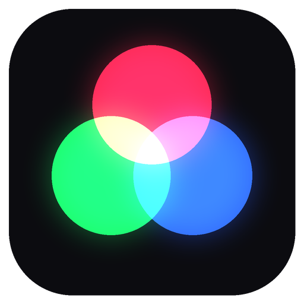
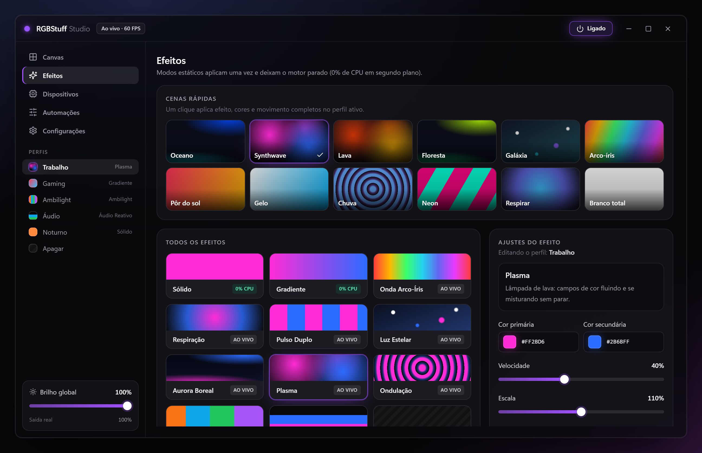
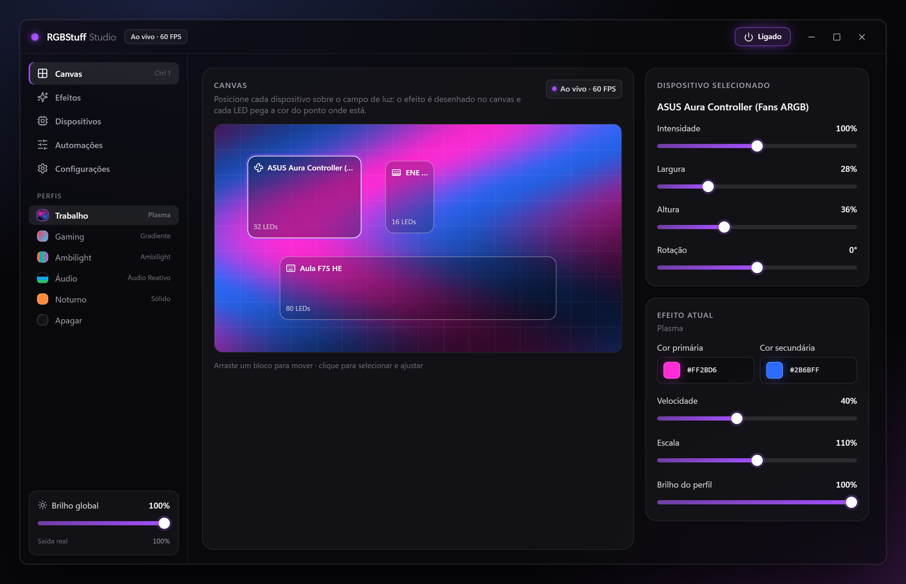
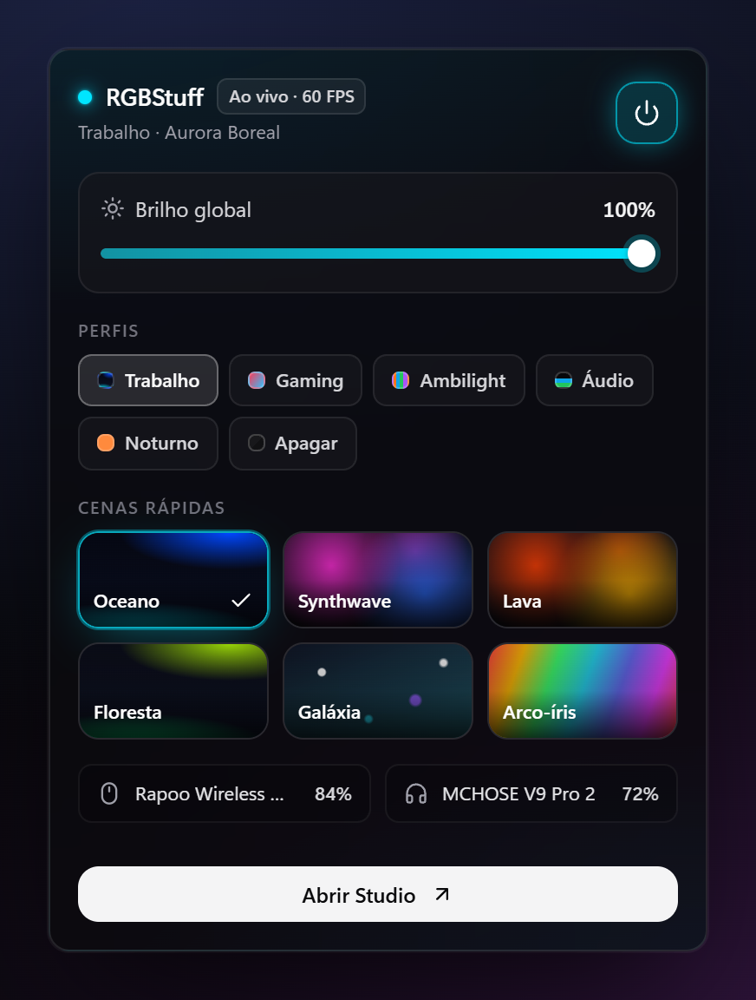

<p align="center">
  
</p>

<h1 align="center">RGBStuff</h1>

<p align="center"><strong>Um app pequeno para todo o RGB da sua mesa.</strong><br>Fans, RAM e teclado num só canvas de luz, bateria do mouse e do headset na bandeja, e 0% de CPU quando nada se mexe.</p>

<p align="center">
  <a href="https://github.com/bps2414/RGBStuff/releases/latest"><strong>Baixar</strong></a> ·
  <a href="#como-funciona">Como funciona</a> ·
  <a href="#hardware-suportado">Hardware</a> ·
  <a href="#perguntas-frequentes">FAQ</a> ·
  <a href="README.md">English</a>
</p>

<p align="center">
  <a href="https://github.com/bps2414/RGBStuff/releases/latest"></a>
  <a href="https://github.com/bps2414/RGBStuff/releases"></a>
  
  
  <a href="LICENSE"></a>
</p>



## Por que o RGBStuff

- **Um app no lugar de quatro.** Cada hub de fabricante quer seu próprio ícone na bandeja, serviço e atualizador. O RGBStuff controla o ARGB da placa-mãe, a RAM e o teclado num único processo em Rust.
- **De graça quando está parado.** Visuais estáticos (sólido, gradiente, apagado) são gravados uma vez e o motor dorme: 0% de CPU enquanto você joga.
- **Mora na bandeja.** Fechar a janela destrói ela e devolve a memória do WebView2; a iluminação continua. Um clique no ícone traz tudo de volta.
- **O setup inteiro vira uma imagem só.** Os efeitos são desenhados num canvas 2D e cada LED pega a cor do ponto onde está, então uma onda atravessa de verdade dos fans até o teclado.

## Como funciona

1. **Instale** o `RGBStuff_<versão>_x64-setup.exe`. Não precisa de administrador nem de baixar o runtime do Visual C++.
2. **Escolha uma cena rápida** (Oceano, Synthwave, Lava, Galáxia…) ou monte a sua em **Efeitos**: só aparecem os ajustes que mudam o efeito atual.
3. **Posicione** os dispositivos no **Canvas** para os efeitos passarem pela mesa do jeito que estão na vida real.
4. **Esqueça dele.** Ligue *Ligar junto com o PC* em **Configurações**: o RGBStuff abre escondido na bandeja e aplica a sua iluminação no boot.



## Recursos

**Iluminação**
- 12 efeitos: sólido, gradiente, onda arco-íris, respiração, pulso duplo, luz estelar, aurora, plasma, ondulação, ambilight da tela, áudio reativo e apagado.
- 12 cenas de um clique, cada uma um visual completo (efeito, cores e movimento).
- Perfis (Trabalho, Gaming, Ambilight, Áudio, Noturno, Apagar) a um clique na barra lateral, no popover e no menu da bandeja.
- **Intensidade por dispositivo até 200%.** Acima de 100% vira boost: conteúdo escuro sobe até o máximo do LED sem mudar a cor, para fans ou RAM que parecem mais fracos que o resto.
- A própria interface brilha com a cor que os seus LEDs estão mostrando.

**Tela e som**
- Ambilight com corte de tarjas pretas, cor dominante viva e transições suaves. A captura da tela só roda com o Ambilight ativo.
- Espectro de áudio via loopback WASAPI, com picos caindo e brilho no grave. A captura para assim que você troca de efeito.

**Automações**
- Perfil por app em foco (ex.: `vlc.exe → Ambilight`, `cs2.exe → Gaming`), com seletor dos apps abertos agora.
- Apaga no Win+L e após inatividade, volta quando você volta.
- Modo noturno com limite de brilho próprio, avisado na barra de título enquanto está ativo.
- Notificação de bateria baixa do mouse e do headset.

**Dia a dia**
- Popover da bandeja: energia, brilho, perfis, cenas e baterias.
- Menu da bandeja: perfis, brilho, ligar/desligar e sair, no mesmo idioma do app.
- O X manda para a bandeja ou encerra, você escolhe. Ctrl+1…5 troca de aba, Ctrl+Shift+L liga/desliga as luzes.
- Todas as janelas ficam sincronizadas: uma mudança na bandeja, no Studio ou numa automação aparece em todo lugar.

<p align="center"></p>

## Instalação

1. Baixe o `RGBStuff_<versão>_x64-setup.exe` da [última versão](https://github.com/bps2414/RGBStuff/releases/latest).
2. Rode. Ele instala para o seu usuário em `%LOCALAPPDATA%`, cria o atalho no menu Iniciar e instala o WebView2 se o Windows não tiver.
3. Abra o **RGBStuff**. O Studio abre na primeira vez; depois ele pode iniciar direto na bandeja.

O SmartScreen pode avisar de editor desconhecido porque o instalador ainda não é assinado. Clique em **Mais informações → Executar assim mesmo**.

Desinstalar por **Configurações → Aplicativos** remove o app e a entrada de *Ligar junto com o PC*. Suas configurações ficam em `%APPDATA%\rgbstuff\RGBStuff\config\config.toml`.

## Hardware suportado

| Dispositivo | Conexão | O que o RGBStuff faz |
| --- | --- | --- |
| Controlador ASUS Aura USB ARGB (`0B05:19AF`) | USB HID | Modo direto por LED nos 2 headers ARGB, quantidade de LEDs por header |
| ENE DRAM RGB (ex.: Asgard DDR4) | SMBus via [PawnIO](https://pawnio.eu) | Modo direto por LED, só endereços SMBus `0x70–0x77` |
| Aula F75 HE (`38A6:2729`) | USB HID | Cor estática e por tecla ao vivo |
| Mouse Rapoo série VT (`24AE:14A1`) | USB HID | Bateria, carregamento, DPI |
| Headset MCHOSE V9 Pro 2 (`3837:6011`) | USB HID | Bateria, conexão |

O RGBStuff instala e roda em qualquer PC com Windows 11 (no Windows 10 deve funcionar, mas não foi testado). Dispositivos sem driver simplesmente não aparecem; o Canvas avisa quando nenhum dispositivo RGB foi encontrado.

## Perguntas frequentes

**Meus fans ou a RAM parecem mais fracos que o teclado.**
Abra **Dispositivos** e suba a **Intensidade** desse dispositivo acima de 100%. Confira também a barra de título: um selo com lua quer dizer que o modo noturno está limitando o brilho agora.

**Cliquei no X e o app fechou.**
Desde a 0.2.0 o X manda o RGBStuff para a bandeja. Se preferir que ele encerre, mude em **Configurações → Ao clicar no X**.

**A RAM aparece desconectada.**
A RAM fica no SMBus, que precisa do driver [PawnIO](https://pawnio.eu) e de privilégio de administrador. Instale o PawnIO e rode o RGBStuff como administrador, ou inicie elevado o `rgb-smbus-svc.exe` (anexado em toda release).

**É seguro com anti-cheat e monitores de hardware?**
O RGBStuff não usa WinRing0. O acesso ao SMBus passa pelo PawnIO assinado, pega o mesmo mutex global de SMBus do HWiNFO, CPU-Z e AIDA64 e recusa qualquer endereço fora de `0x70–0x77`, então a SPD EEPROM (`0x50–0x57`) não pode ser tocada.

**Meu dispositivo não está na lista.**
Abra uma [issue](https://github.com/bps2414/RGBStuff/issues) com a saída de `cargo run -p hid-probe -- list`. Os drivers são módulos Rust pequenos e isolados em `crates/rgb-drivers`.

## Por dentro

Um app Tauri 2 com núcleo em Rust e interface em React 19. O motor desenha os efeitos num canvas de 128×72, amostra cada LED de forma bilinear, controla o ritmo de cada barramento (Aura 60 Hz, teclado 30 Hz, RAM 15 Hz) e pula frames que não mudaram. As janelas são criadas sob demanda e destruídas ao fechar; a thread do motor e a bandeja continuam rodando.

```text
crates/
  rgb-core        cores, config (TOML atômico), traits de dispositivo, importador de hubs
  rgb-engine      canvas, efeitos, ritmo de frames, sono com 0% de CPU
  rgb-drivers     ASUS Aura USB, ENE DRAM, Aula F75 HE, Rapoo, MCHOSE
  rgb-capture     ambilight via DXGI, loopback WASAPI + FFT
  rgb-automation  bloqueio, suspensão, inatividade, horário noturno, app em foco
  rgb-smbus-svc   serviço SMBus elevado opcional (PawnIO)
apps/desktop      Tauri 2 + React 19 + Tailwind 4 + Radix UI + Zustand
tools/hid-probe   CLI de sondagem de hardware
```

Detalhes em [docs/ARCHITECTURE.md](docs/ARCHITECTURE.md).

### Compilando

Windows com Rust (MSVC) e [Bun](https://bun.sh):

```powershell
cd apps\desktop
bun install
bun tauri build      # instalador em target\release\bundle\nsis\
cargo test --workspace
```

`bun tauri dev` roda o app com hot reload; `bun run dev` sozinho mostra a interface no navegador com dispositivos de exemplo.

## Licença

MIT. Veja [LICENSE](LICENSE).

O RGBStuff é um projeto independente, sem vínculo com ASUS, Aula, Rapoo, MCHOSE ou qualquer fabricante. Os nomes aparecem só para descrever compatibilidade.

---

<p align="center">Se o RGBStuff substituiu um ou dois hubs no seu PC, uma ★ no repositório ajuda outras pessoas a encontrarem ele.</p>
